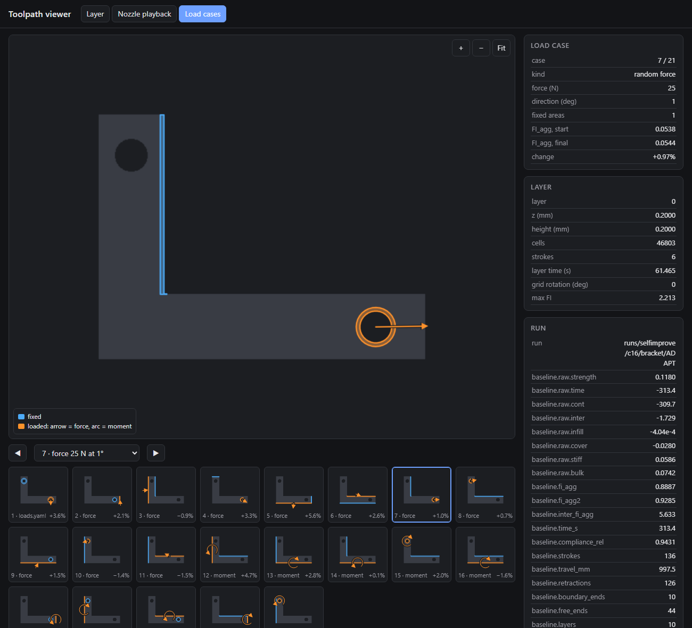
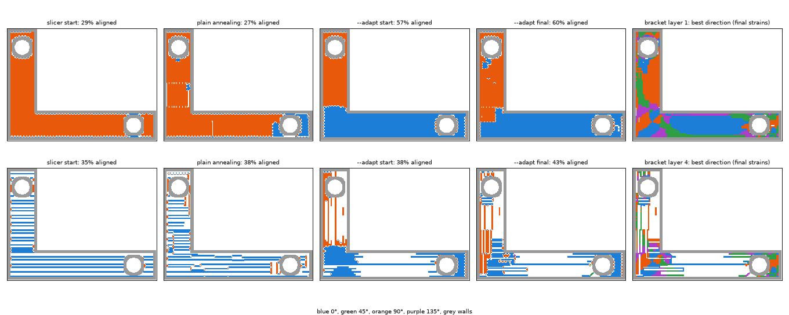
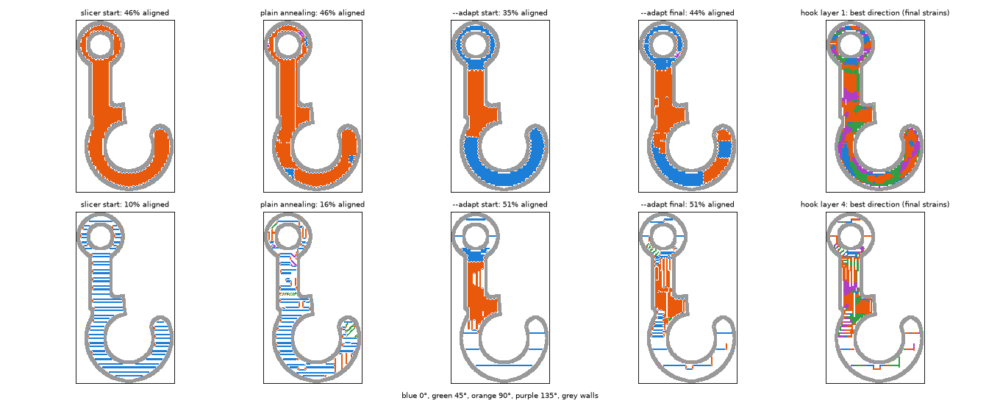
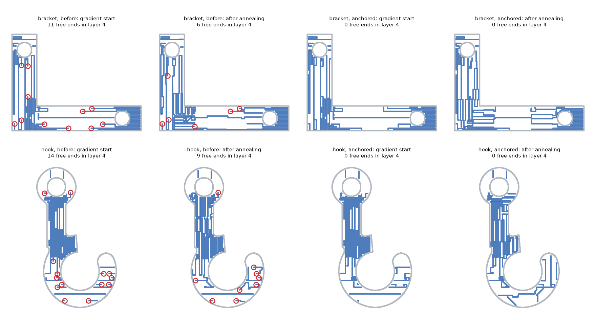

# rltp — RL toolpath optimizer

`rltp` slices a mesh into layers with fixed walls, solid top and bottom skins and
sparse infill (or fully dense layers), covers each layer's filled cells with paths
and loops (every filled cell visited exactly once), and improves the toolpath and
where the infill goes one edit at a time — with a trained policy, simulated
annealing, best-of-N greedy search, or random edits, all in the same loop
with the same evaluator. It writes G-code, a self-contained HTML viewer that
plays back nozzle motion and the optimizer's history, and a replayable log.

See `RL Toolpath Optimizer — Design Doc.md` for the design and
[docs/evaluator.md](docs/evaluator.md) for how a toolpath is scored, term by term. This
README covers usage and what is (and is not) implemented.

## Install

```bash
uv venv --python 3.11 .venv
uv pip install --python .venv/bin/python torch --index-url https://download.pytorch.org/whl/cpu
uv pip install --python .venv/bin/python -e ".[test]"
```

`rltp train` and `rltp bench` start their workers with `fork`, so run them on Linux, or in WSL on
Windows.

## Use

```bash
# slice + baseline covers (zigzag | zigzag90 | concentric), no optimisation
rltp baseline examples/bracket.stl --printer configs/printer.yaml --loads examples/bracket_loads.yaml --out out/base

# optimise with simulated annealing (the default proposer)
rltp optimize examples/bracket.stl --loads examples/bracket_loads.yaml --printer configs/printer.yaml \
              --weights 1.0,0.3,0.3 --out out/opt
rltp optimize ... --proposer sa|greedy|random|policy|policy-sample --max-evals 20000 --interlayer --rotate
rltp optimize ... --load-cases 10 --load-moments 10 --load-seed 0   # also score strength on 20 random
                                     # cases: each fixes one outline edge and pushes or twists another
rltp optimize examples/hook.stl --printer configs/printer.yaml --out out/hook   # no loads.yaml: strength
                                     # over 20 random cases, none special (load-agnostic)
rltp optimize ... --load-weights 3,2,1   # odds of a random case using a hole, side or arc ('uniform': all alike)
rltp optimize ... --walls 1 --solid-layers 2 --infill 0.4 --max-bridge 4   # the printer.yaml defaults
rltp optimize ... --infill 0.3 --infill-rule both --infill-band 0.02 --infill-weight 1   # remove 70%
rltp optimize ... --cell 0.1          # 0.1 mm grid: 0.4 mm beads placed anywhere to 0.1 mm (SA/greedy/random)
rltp optimize ... --fea-element 0.4   # coarse stress mesh: 4x4 cells of 0.1 mm per element, ~10x faster
rltp optimize ... --cell 0            # 0.4 mm grid (one cell per bead; needed for --policy)
rltp optimize ... --solver legacy     # the original FEA solver, to reproduce older runs bit for bit
rltp optimize ... --start stress --stress-bias 0.5 --strength-first 3   # direction guidance
rltp optimize ... --start gradient     # directions and infill density optimised for strength first
rltp optimize ... --adapt              # toolpaths that adapt to the loads (see Self-improvement cycles)
rltp optimize ... --clamp-band 1.0     # leave each load case's own support/load edges out of its FI
rltp optimize ... --guide 0.8          # 80% of proposals re-lay a window in its best bead direction
rltp optimize ... --adapt --pack 0.25  # a quarter of those pack the window's lines where infill is
                                       # worth most (score's density gradient), e.g. beside walls
rltp optimize ... --directions path    # score each bead along its own path (fitted tangents), not as
                                       # the worst 0/45/90/135 class its grid steps hold (curves!);
                                       # G-code, print time and material follow fitted straight moves
rltp optimize ... --directions path --adapt --start gradient16 --line-bins 16
                                       # bead lines every 11.25 degrees: the gradient start rounds its
                                       # direction field to 16 bins, guided refills lay each window at
                                       # the best of 16, turn16 edits turn areas by one bin
                                       # (experimental: on frame/plate/wrench it ties or trails the
                                       # four classes on strength at +7-8% print time; CYCLES.md c20)
rltp optimize ... --free-end-cost 1    # continuity cost per path end that touches no other bead (0: off)
rltp optimize ... --infill-lines whole # gradient start: lay each infill line's run whole (default cut:
                                       # lines start and stop with the density field, ends T-jointed)
rltp optimize ... --chains 4 --workers 4 --reheat 0.5   # 4 annealing chains, keep the best; reheat on stalls
rltp optimize ... --walls 0 --solid-layers 0 --infill 1                    # every cell filled (original mode)

# train (frozen, 0.4 mm grid only): imitation warm-start then PPO through the curriculum
rltp train --config configs/train.yaml --out runs/exp01/

# PNG / GIF frames for slides (MP4 when ffmpeg is installed)
rltp render out/opt --mode layer|playback|history --layer 3 --format gif

# the evaluation plot: score vs evaluator calls on held-out shapes, all proposers
rltp bench --policy runs/exp01/policy.pt --families ribs --shapes 16 --budget 1024 --out bench/
```

Each `baseline`/`optimize` run writes `part.gcode`, `viewer.html`,
`history.jsonl`, `metrics.json`, plus `state.npz` (used by `render`).

The viewer has four tabs:
- **Layer**: bead direction, print order, failure index or strokes per layer.
- **Nozzle playback**.
- **Optimization history**: replays the edits, with the score chart.
- **Load cases**: every case the strength term scores, as a thumbnail grid. Each thumbnail
  shows the fixed area in blue and the loaded area in orange, with an arrow for a force or an
  arc for a moment, and the case's FI_agg change over the run. Click a thumbnail, or use the
  arrow keys, for its details. `viewer.html#loads:12` opens case 12.

`viewer.html#layer:12` opens layer 12. With `--directions path`, the Layer and Nozzle playback tabs
draw the fitted moves the G-code prints, each coloured by its true angle (the **printed path**
toggle; off shows the bead grid's node staircases). The History tab always shows nodes.
`python scripts/run_viewer.py RUN_DIR ...` writes `viewer.html` for suite runs made without
`--viewer`, from their saved states and history.



`--weights` is strength, time, continuity, (v1.5) interlayer, infill target, coverage,
stiffness and bulk strength, in that order. A zero weight turns that term off.
`--interlayer` turns on the v1.5 term with weight 0.3.
With walls/infill the interlayer term (Z bonding) is on at 0.3 unless you give a fourth
weight, the fifth comes from `infill_weight`, and on a fine bead grid the sixth (coverage)
from `cover_weight`. The seventh, **stiffness**, is −ln of the mean over load cases of
compliance relative to the slicer layout. The eighth, **bulk**, is −ln of the p = 2
aggregate of FI. Strength uses p = 8, which follows the few most loaded cells (mostly walls),
while bulk sees how well the beads suit their loads across the whole part. Both are off
unless given; the self-improvement cycles below used `--weights 0.5,1,1,0.3,1,1,0.5[,0.5]`.
Each term is scored as a fraction of the part's baseline value, so a weight is the importance
of a 1% change. With `1.0,0.3,0.3`, a 1% drop in FI_agg is worth a 3.3% rise in print time.
To favor continuity, raise the third weight. `--norm std` restores the original per-edit-std
scaling, and `--burst-bans` the original per-burst ban list. Both exist for comparison only.
`--rotate` is v0.5: each layer's grid is rotated to the dominant principal stress
direction from one isotropic FEA of that layer.

### Inputs

- `configs/printer.yaml`: motion (speed, accel, junction deviation), retraction,
  temperatures, start/end G-code templates, **material constants** (E1, E2, G12,
  ν12, Xt, Xc, Yt, Yc, S, Zt, Sz) and the **bond model** (τ, n, s_end, q_min).
  **Shell and infill**: `walls` (1), `solid_layers` (2), the `infill` target (0.4, i.e.
  remove 60% of the inside), how it's held (`infill_rule`, `infill_band`, `infill_weight`)
  and `max_bridge` (4 mm). **Grid and analysis**: `cell` (0.1 mm: beads placed to 0.1 mm;
  0 for the 0.4 mm grid), `cover_weight` (1) and `fea_element` (0.1 mm). Setting walls and solid layers to 0 and infill to 1 fills every
  cell, the original mode; the code's built-in default is that mode too.
  The material values are generic-PLA placeholders. That's enough to rank toolpaths for the
  same part against each other, which is how the strength term is used; coupons are only
  needed for absolute numbers.
- `loads.yaml` (see `examples/`): `supports` and `loads` are 2D regions in world
  XY (`box`, `circle`, `polygon`, `side: xmin|xmax|ymin|ymax` with `width`, or `edge`: a
  polyline and the points within `width` of it), each load with a total force `[Fx, Fy]`
  and optionally a `moment` (N·mm about z), split across layers by `h / height`.
  `point_loads` (`pos: [x,y,z]`, `force: [Fx,Fy,Fz]`, mesh coordinates) drive
  the v1.5 interface statics. A `material:`/`bond:` block here overrides the
  printer's.
- Extra load cases in `loads.yaml`: `load_cases` is a list of cases, each a list of
  loads written like `loads`; they share the `supports`. `random_cases: N` and
  `random_moments: N` add N random force and moment cases, seeded by `random_seed`
  (`--load-cases`, `--load-moments`, `--load-seed`). In the default `random_mode: edge`,
  the outline is split into edges (sides, arcs, round holes) and each random case fixes one
  random edge and pushes or twists another: a hole, side or arc with odds `random_weights`
  (`--load-weights`, default 3,2,1), then an edge of that kind by length. `random_mode: disc`
  (`--load-mode disc`) gives the older cases: a small disc load on the outline with the
  loads.yaml supports.
- **No `loads.yaml` (load-agnostic).** Without `--loads`, strength is scored over 10 random
  force and 10 random moment cases and none is special: the aim is a good strength
  distribution for parts whose loads aren't known. See the design doc's "Load-agnostic
  strength".

## Layout

```text
rltp/
  config.py           printer / material / bond / loads / score settings
  model.py            Frame, Layer (mask, frame, nxt/prv, seams)
  part.py             PartState: cached evals, incremental deltas, full re-check, best part
  io/mesh.py          load + repair (trimesh), fails loudly if not watertight
  slicing/slice.py    section_multiplane -> shapely polygons (mid-layer cuts)
  slicing/raster.py   polygon -> cell mask (contains_xy), layer frames
  slicing/edges.py    outline -> edges (sides, arcs, round holes) for the random load cases
  cover/cover.py      nxt/prv arrays, invariants, stroke walking, joins, seams
  cover/baselines.py  zigzag, concentric (ring peeling), greedy repair pass
  cover/ops.py        the 20 edit operators (10 path, 5 fill, 5 moves) + vectorised action masks
  cover/shell.py      walls, solid skins, starting infill, the support rule
  cover/beads.py      fine bead grid: deposition model, layout, 0.1 mm edits, line bins, pack,
                      fitted printed segments (--directions path)
  cover/paths.py      each bead node's true direction (tangent fit), per-cell direction mix
  eval/fea2d.py       plane-stress Q4, orthotropic beads, Tsai-Wu, p-norm, warm-started PCG;
                      one linear system per set of supports, coarse or refined elements
  eval/adapt.py       diagnostics: bead directions changed, alignment with the best direction
  eval/timing.py      trapezoidal motion + junction deviation, travel/retract
  eval/metrics.py     continuity, layer evaluation, running term normaliser
  eval/interlayer.py  v1.5 interface statics + bond quality
  eval/stressmap.py   one isotropic stress solve for the stress-aligned start
  rl/obs.py           26 observation channels (no torch import)
  rl/env.py           Gymnasium LayerEnv
  rl/shapes.py        procedural shape families, random supports/loads
  rl/net.py           U-Net policy + value heads (2.1M weights), PolicyProposer
  rl/imitate.py       best-of-N teacher -> behaviour cloning
  rl/ppo.py           masked PPO, subprocess envs
  rl/train.py         curriculum driver
  search/sa.py        random / SA / greedy proposers
  search/guide.py     direction map: where turning beads lowers the score's FI most, guided refills
  search/fields.py    gradient layout step: field model, adjoint, starts, line-end cost
  search/chains.py    parallel annealing chains, best final kept
  search/parallel.py  forked worker processes (the field starts and the chains)
  loop/optimize.py    part loop, scheduler, reheating, history log
  export/gcode.py     strokes -> G-code
  export/viewer.py    JSON + template -> viewer.html
  export/render.py    matplotlib PNG/GIF/MP4 frames
  bench.py            score-vs-evaluator-calls comparison
  cli.py
scripts/
  suite.py            run settings on the test parts in parallel; adaptation measures per run
  cycles.py           roll up the suite summaries
  compare.py          score runs against one reference on one footing
  rescore.py          rescore saved layouts under another run's settings
  direction_maps.py   start / final / best bead directions per layer (PNG)
  run_viewer.py       viewer.html for finished suite runs
  analysis/           one script per question asked during the cycles (see How the cycles are run)
examples/
  make_parts.py       the hook, frame, wrench and plate test parts (STL + loads.yaml); --only NAME,...
  2mm/                the 2 mm parts used through cycle 17
```

## Status against the design doc

**Direction (Nov 12, 2026).** Parts are optimized by searching directly against the
evaluator, with simulated annealing by default. The RL policy is frozen: it still runs on the
0.4 mm grid (`--proposer policy`, `rltp train`, `rltp bench`) but isn't retrained or
extended. Next come a gradient layout step for strength (built: `--start gradient`; see the
results below), parallel chains (independent chains built: `--chains`), cheap screening and
learning within the run; see the design doc's Search against the evaluator. On the 0.1 mm
bracket, `--start gradient --chains 4` with D's guidance reaches +56.5 against D's +43.3,
better on every term. On a second part, a pin-loaded link, it reaches +74.9 against +62.5
from the stress start and +57.9 from the slicer start at the same budget.

**Adapting to the loads (Nov 14, 2026).** Fifteen self-improvement cycles found why
toolpaths barely changed: the strength term sat almost entirely in locked walls at clamp
edges, proposals weren't aimed, and starts weren't scored on a common footing with several
load cases. `--adapt` now gives on average −9.1% FI_agg against −0.5% for plain annealing
over 21 load cases on five parts, with print time within about 1%. Two later cycles moved
the default to one wall (16) and anchored every infill line end to a wall or another bead
(17). See
[Self-improvement cycles](#self-improvement-cycles-making-toolpaths-adapt-to-the-loads-nov-14-2026).

**Unknown loads, 5 mm parts, true directions (Nov 15–16, 2026).** The parts are now 5 mm
thick, and suite runs score strength over random load cases with none special. `--adapt`
lowers FI_agg by 26–51% against the slicer start (c18–c20; c18 at 5–14% more print time).
`--directions path` scores and
prints beads at their true angles. Lines every 11.25° (`--line-bins 16`) lost to the four
classes, and packing lines by worth (`--pack`) saved print time but grew no wall-like band.
The score now sits in a few hot spots at inside corners and hole edges, largely in the locked
walls. Most strength-improving edits are rejected because their new lines leave loose ends.
See [Cycles 18–20](#cycles-1820-thicker-parts-unknown-loads-true-bead-directions-nov-1516-2026)
and [How the cycles are run](#how-the-cycles-are-run).

Implemented: v0 (single nozzle, 4-neighbour grid; strength, time, continuity),
v0.5 (per-layer grid rotation), v1.5 (interlayer term from interface statics),
i.e. the software side of milestones M0–M5.

Not implemented, deliberately: v1 triangular lattice (the doc gates it on
0°/90° beads proving limiting), v2 3D FEA stress maps (gated on Z coupons
failing where v1.5 predicted they'd hold), v3 dual nozzles / rotating bed (M7).
Physical validation (test prints, coupons, PrusaSlicer time comparison,
Klipper testing) is outside what code can do. Strength is treated as a relative,
theoretical score with placeholder material constants. The goal is good continuity and
decent strength, not calibrated strength predictions (see the design doc's Priorities),
so coupon work is deferred.

Interpretation choices worth knowing:

- **Seams** are stored as a set with one cell per closed loop; `Layer.seam_dict()`
  gives the doc's loop-id → cell form.
- **Flip right/down** act on the 2×2 block whose top-left is the chosen cell:
  "right" swaps a horizontal link pair for a vertical one, "down" the reverse.
- **Merge** picks the first adjacent end on a different stroke (E, S, W, N),
  falling back to closing the stroke's own ends into a loop (only ≥ 3 cells, so no 2-cycles).
- **Stroke order** is greedy nearest-neighbour from the layer's grid origin, so
  a layer's timing never depends on other layers (keeps edits local).
- **Failure index** is the Tsai-Wu inverse strength ratio (≥ 0, linear in load).
  Corner cells average the two stiffnesses and take the larger FI of the two
  material frames.
- **Term scales**: each term's change is divided by its value on the part's baseline.
  Strength and interlayer are −log FI_agg, already fractional, so they use a scale of 1.
  The loop, the bench and the RL env all use the same rule, so training rewards and
  loop scores agree. The loop's 128 warmup edits now only measure a typical edit's
  score change, which is the unit for annealing temperatures.
- **Rejected edits** stay banned until their layer changes, or with the interlayer
  term, until a neighbor changes. The loop stops when no layer has an untried edit left.
- **Load cases.** With more than one case, each case's FI is divided by its own baseline
  FI_agg, and FI_agg becomes a p-norm over every cell of every case, so it starts at 1 and
  force sizes drop out. The p-norm acts as a soft worst case: no case can be traded away
  for another. A random case is a disc load (4 cells in radius) at a random point on the
  outline away from the supports, in a random direction. `metrics.json` lists every case and
  reports each one's raw FI_agg as `case_fi_agg`; `fi_agg` is then the combined value.
  Observations and `--rotate` take stress directions from case 0, the `loads` block.
- **Shell and infill.** Walls are the outermost rings of cells around every outline, holes
  included, traced into closed loops and locked: no edit may change a wall's links, only
  its seam. Where a section is too thin for two rings each side, the inner ring stays an
  open path. A cell is solid if any of the `solid_layers` layers above or below lacks it,
  as slicers do it, so steps and ledges get skins too. Walls and solid cells must stay
  filled; every other cell is optional. The starting infill is rectilinear lines placed so
  the filled share of optional cells matches the target. `infill_pattern: stacked` (the
  printer.yaml default) runs every layer's lines the same way, so adjacent layers overlap
  and bond; `alternate` switches 0°/90° by layer. Skins alternate either way.
- **Infill target.** `infill` is the share of optional cells to keep (0.4 removes 60% of
  the inside). `infill_rule: penalty` adds a fifth score term, minus the distance from
  target, with weight `infill_weight`: weight 1 makes one percentage point off target cost
  as much as a 1% change in a weight-1 term. `band` rejects any edit that would take the
  part's infill outside target ± `infill_band` (or, from outside, further from it). `both`
  (the default) is the penalty inside the band. `free` uses the target only for the
  starting layout. A fifth `--weights` entry overrides `infill_weight`.
- **Support rule.** A filled cell must be within `max_bridge`/2 of a filled cell in the
  layer below, unless that layer has no part there at all. Removing cells must not strand
  anything above. The starting line pitch is capped at `max_bridge`.
- **Fill edits.** `add` and `remove` one optional cell, `fill5_0`/`fill5_90` fill a 5×5
  window's optional cells and zigzag it, and `clear5` empties a 5×5 window. Time and
  continuity count every filled cell, which is what makes material cost something. The
  trained policy only proposes the 10 path edits; annealing, greedy and random use all 20.
- **Moves** keep the layer's infill count: `add_trim`/`fill5_trim` add a cell (fill a 5×5
  window) and then trim as many path-end cells elsewhere in the layer; `remove_grow`/
  `clear5_grow` remove a cell (clear a window) and extend as many path ends. Trimming takes
  unbonded cells (nothing filled directly below or above) first, then the least stressed;
  growing takes bonded cells first, then extends the most stressed ends. Working at path
  ends keeps strokes whole. `stack9` copies the layer below's infill into a 9×9 window,
  so it bonds fully there, zigzags it along the copied lines, and trims or grows elsewhere
  to keep the count: the one edit that lines infill up between layers.
- **Z bonding (sparse parts).** Only cells filled in both layers bond, so the interlayer
  term's section is the bonded set, recomputed for every edit: less overlap between
  adjacent layers' toolpaths gives a smaller section and higher interface stress. It
  scores a generic pull and bending about both axes (sized so a fully bonded interface
  peaks at half the interlayer strength), plus any `point_loads` above the cut, along
  with the existing bond quality (time gap, stacked ends). `metrics.json` reports
  `bonded_pct` and `weakest_bond_pct`.
- **Stack model.** Sparse parts default to a laminate: bonded layers stretch together, so
  one plate with every layer's stiffness carries the whole load, and each layer's stress
  follows from that shared strain and its own beads and fill. The original split (each
  layer carries h/height of the load alone) charged sparse middle layers a solid layer's
  share and put the bracket's FI_agg at 2.8× the dense part's. `--stack split|laminate`
  picks either. Empty cells keep 0.1% stiffness and count as FI 0.
- **Stress mesh.** `fea_element` (mm, printer.yaml default 0.1) splits each cell into
  elements of that size for the strength analysis only. Each cell's FI is the p-mean of its
  elements', so FI_agg keeps its meaning. On the bracket, 0.1 mm elements raise FI_agg about
  35% over 0.4 mm ones (stress peaks at the holes and the inside corner get resolved) at
  about 19× the cost per edit; layouts optimized on the coarse mesh still improve under the
  fine one, by less. The cantilever test converges to beam theory as elements shrink.
- **Fine bead grid (`cell: 0.1`).** Cells are 0.1 mm and beads stay 0.4 mm (4 cells). A
  layer's paths are bead centerlines in 0.1 mm steps, so beads can sit at any 0.1 mm position
  and jog sideways. Material per cell is what the nozzle lays: each step a strip 4 cells wide,
  half-bead caps at path ends, the outer quarter at corners. A straight bead gives exactly 1,
  two overlapping beads 2. The FEA uses that material (stiffness min(D, 1), bead direction
  from the strips), and support, infill share and Z bonding count cells with D ≥ 0.5. Walls
  are centerline loops a whole bead apart along the true outline (accurate to 0.1 mm). Exact
  cover by 0.4 mm beads is usually impossible, so a coverage term (`cover_weight`, the sixth
  weight) charges gaps in walls/skin and any over-extrusion. Edits: shift a straight run one
  cell sideways, extend or retract a path end, join nearby ends with an L-shaped connector,
  refill a 1.6 mm window with beads 0.4 mm apart on the row or column the edit picks, clear
  a window's optional beads, copy the layer below into a window; reverse, split and
  move_seam carry over. The trained policy only knows the 0.4 mm grid, so fine grids use
  `--proposer sa|greedy|random`. Cells per bead must be even.
- **Directions.** `--start stress` lays each area's skin and infill along its main stress
  direction (0 or 90 degrees) from one isotropic stress solve; `stress4` adds 45/135-degree
  areas (fine grid). `--stress-bias F` places that share of proposals by local stress;
  `--strength-first X` starts the strength weight X times higher, easing back over annealing.
  `--start gradient` first optimises a bead-direction field and an infill-density field
  for in-plane strength (`rltp/search/fields.py`: the laminate strength term as a function
  of both fields, its adjoint gradient, about 45 s on the 0.1 mm bracket), then lays them out:
  0/90 areas, and infill lines that start and stop with the density field (`gradient4`
  adds 45/135 areas).
- **Gradient start and chains.** The field step runs from `--field-starts` (default 8)
  starting direction fields in parallel, each with continuation (`--no-field-continuation`
  skips it), and charges the bead-line ends it causes (density changes and direction-area
  boundaries) at the run's continuity and time weights (`--field-end-cost X` scales the
  fitted price, default 1; 0 ignores line ends). It lays every start out and
  ranks them by the whole score. `--chains N` runs N annealing chains in parallel (seeds
  seed..seed+N−1, from the `--chain-starts` best field starts in turn, default 1) and keeps
  the best; each chain's history and metrics go to `out/chain<i>/`. `--reheat F` anneals
  again from F × the starting temperature once greedy passes stall. `--workers` caps the
  processes; set `OMP_NUM_THREADS=1`. Parallel work needs fork (Linux, WSL); elsewhere the
  starts and chains run one after another.
  Refills come in 1.6, 3.2 and 6.4 mm and keep the area's infill share; `flip_region` and
  `turn_region` turn a whole same-direction area by 90 or 45 degrees.
- **Diagonal beads (fine grid).** A staircase of one-cell steps (6 or more, constant signs) is
  a straight diagonal bead: deposited as a rotated bead, printed and timed as one straight
  move, and modelled with 45/135-degree stiffness and strength. `refill_45/135` lay them.
- **Not built on purpose:** extra walls or infill where stress is high as a rule, to see
  whether the optimizer gets there itself (see the design doc). Annealing doesn't; the
  gradient start does, by optimizing the strength term.
- **Not yet with walls/infill:** `--rotate`, and a policy trained with the fill edits.
- **LayerEnv** follows the loop at temperature 0. A proposal that doesn't raise the
  score is not applied, earns 0, and is masked until the next accepted edit.
  `accept: all` in a training config restores the original env.

## Self-improvement cycles: making toolpaths adapt to the loads (Nov 14, 2026)

The question: toolpaths barely changed from their starting layout under optimization. Fifteen
cycles of run, analyse, change, rerun followed, with that question first. Cycle 16 moved to
[one wall](#one-wall-cycle-16), and cycle 17 [anchored the infill lines](#anchored-infill-lines-cycle-17).

**Setup.**
- **Parts.** Five: the bracket, the link and three new ones from `examples/make_parts.py`.
  - **Hook:** held at its eye, pulled in its throat.
  - **Frame:** a window plate bolted at two holes, its far end pushed.
  - **Wrench:** jaw held, handle pushed.
  - **Thickness.** 2 mm (10 layers) through cycle 17; those files are in `examples/2mm/`.
    The parts in `examples/` have been 5 mm (25 layers) since Nov 15, 2026, with each primary
    load resized so the slicer start's FI\_agg stays near 1.
- **Loads.** Each part has 21 load cases: its `loads.yaml` case plus 20 random edge cases
  (`--load-cases 10 --load-moments 10`). Each random case fixes one outline edge and pushes
  or twists another.
- **Printer.** `configs/printer.yaml`: 0.1 mm cells, 2 walls (the default then; it's now 1,
  see [One wall](#one-wall-cycle-16)), 3 solid layers top and bottom (now 2, with the 5 mm
  parts), 40% infill.
- **Analysis mesh.** 0.4 mm elements (`--fea-element 0.4`).
- **Weights.** 0.5/1/1, plus the sparse-part defaults: Z 0.3, infill 1, coverage 1.
- **Search.** Annealing with 3,000 evals per run, seed 0, one run per part per setting.
- **Runner.** Everything runs through `scripts/suite.py`.

**Measures** (from `rltp/eval/adapt.py`):
- **Objective:** the README's weighted % change against each part's slicer start.
- **FI_agg:** the strength aggregate.
- **Bulk:** the p = 2 aggregate.
- **Directions changed:** the share of bead cells whose direction changed.
- **Aligned:** the FI²-weighted share of bead cells lying in their best direction (of
  0/45/90/135°) under the current strains. It measures how far the beads suit their loads.

### Why the toolpaths didn't adapt (cycle 0)

Plain annealing from the slicer start gained +35 to +57 points, all of it continuity, time
and Z. FI_agg moved −0.3% to +0.3%, and the aligned share didn't rise on any part. The wrench
turned 18.5% of its bead cells and ended *less* aligned. Directions changed for continuity's
sake, at random with respect to the loads. Three causes:

1. **The strength term couldn't see bead directions.** At the start, 71% (bracket) to 81%
   (hook) of Σ FI⁸ sat in wall cells within 1 mm of a load case's own support or load
   region. Those are the singular ends of a rigid clamp or a concentrated load. Another
   17–20% sat in other wall cells. The bead cells that edits can turn held 1–9%. Walls are
   locked, so no edit could move the score much.
2. **Proposals weren't aimed.** Edits were drawn uniformly over ~20 operators and every
   cell, and a window re-lay picked its angle at random.
3. **Each start was scored against its own reference.** With several load cases, the stress
   and gradient starts re-measured each case's scale on their own layout, so their FI_agg was 1
   by construction. The field step's ranking was unaffected, but no start's strength could
   be compared with another's.

### The cycles

Results are means over the five parts unless noted, scored with each cycle's own weights
against the slicer start. From cycle 9 on, they're scored with cycle 8's weights.

| cycle | change | result | kept |
| --- | --- | --- | --- |
| 1 | `--clamp-band 1`: per case, leave cells within 1 mm of its own regions out of its FI. `--guide 0.5`: half the proposals re-lay a window, placed where turning beads would lower the score most, at the window's best direction | FI_agg −3.0% (was −0.1%); directions changed 12.1% (7.7%); objective +48.1 (+45.6). Guided edits brought ~90% of the strength gains | yes |
| 2 | stiffness term (7th weight 0.5): compliance against the slicer layout | FI_agg −3.6%, objective +49.4; compliance moved only 0.3–1.9% (E1/E2 = 1.27). Weight 1.5 (2b): a little more alignment, same strength | yes, at 0.5 |
| 3 | `--align 0.5`: re-lay the whole connected area sharing a best direction | worse on 4 of 5 parts (e.g. link +45.8 against +58.3): a quarter of the budget, 3–6% accepted | no |
| 4 | gradient start (with the reference fix) + band + guide | **objective +62.5 against +49.7, FI_agg −7.9% against −3.7%**, better on every term; the stress start was up to 42% *worse* than the slicer layout over 21 cases | yes |
| 5 | guide share 0.5 → 0.8 | aligned share 0.336 (0.317), directions changed 12.5% (10.6%), same objective and strength | yes |
| 6 | bulk term (8th weight 0.5): −log of the p = 2 aggregate; the guide scores directions by the weighted objective | aligned 0.338; bulk FI −0.7 to −2.2%. At 0.5 a 1% bulk gain (0.5 points) can't pay for a re-lay's continuity cost (~0.5 points) | yes, weight raised in 8 |
| 7 | budget 3,000 → 6,000 evals (3 parts) | more continuity (hook +46.2 against +37.9), not more strength or alignment | no |
| 8 | bulk weight 2 | aligned 0.362 (0.336), FI_agg −4.0% (−3.7%), bulk −1.9%, print time ~1% longer | yes |
| 9 | gradient start + guide 0.8 + bulk 0.5 in the field step too | objective +68.3, FI_agg −8.8%, bulk −4.3%, worst case −0.1% | yes |
| 10 | annealing temperature 0.1 → 0.3 | aligned 0.376 but objective +46.2 (+49.8): exploration without recovery | no |
| 11 | gradient start with bulk 2 (3 parts) | aligned **0.442** against 0.363 at bulk 0.5 on the same parts; FI_agg −8.4% (−7.8%), bulk −5.1% (−4.2%), worst case +0.1% (+0.7%) | yes |
| 12 | speed: the field model checks each wall cell only in the directions it holds | field-model evaluation 3.0 → 1.6 s with 21 cases, same values | yes |
| 13 | `--z-fi ratio`: the Z index as a strength ratio (the quadratic index at p = 8 acts like p = 16; a stacked path-end pair weighs 300×) | Z spikes per re-lay about a third; a little more continuity, the same strength and alignment | option only |
| 14 | seed replicate of cycle 8 (seed 1) | per part the objective moved by up to 8 points (link), the 5-part means by 1.3; FI_agg means by 0.1 points, aligned by 0.002. Mean differences under ~2 points of objective, ~0.3 points of FI_agg or ~0.01 of aligned share are noise | — |
| 15 | final validation: `--adapt` on all five parts | objective +69.7 against +45.7 for plain annealing; FI_agg −9.1% (−0.5%), bulk −4.9% (+0.1%), worst case −1.1% (+2.0%), aligned 0.412 (0.293; slicer start 0.302) | — |

`--adapt` sets the kept settings, each only where the command line leaves the default:
- `--start gradient --clamp-band 1 --guide 0.8 --stress-bias 0.5 --strength-first 3`
- stiffness weight 0.5 and bulk weight 2.

### Where it ends up

Each layout is scored under the final objective (clamp band, the 21 load cases, the
stiffness and bulk terms) against its part's slicer start (`scripts/rescore.py`).
- **Plain annealing** is cycle 0's run, the behaviour before the cycles.
- **Guided annealing** is cycle 8: slicer start, guide 0.8, bulk weight 2.
- **`--adapt`** is cycle 15.

Means over the five parts:

| layout | objective | FI_agg | bulk | worst load case | aligned |
| --- | --- | --- | --- | --- | --- |
| slicer start | 0 | — | — | — | 0.302 |
| plain annealing | +45.7 | −0.5% | +0.1% | +2.0% | 0.293 |
| guided annealing, slicer start | +49.8 | −4.1% | −1.9% | +0.5% | 0.362 |
| `--adapt` | **+69.7** | **−9.1%** | **−4.9%** | **−1.1%** | **0.412** |

Per part (objective / FI_agg / aligned):

| part | plain annealing | guided annealing | `--adapt` | print time, slicer → `--adapt` |
| --- | --- | --- | --- | --- |
| bracket | +40.7 / −0.7% / 0.341 | +46.8 / −3.1% / 0.407 | +65.3 / −7.8% / 0.507 | 339.7 → 341.5 s |
| link | +49.5 / +0.3% / 0.246 | +53.3 / −2.6% / 0.317 | +78.2 / −11.3% / 0.391 | 369.8 → 369.9 s |
| hook | +44.9 / −0.9% / 0.275 | +44.5 / −3.7% / 0.363 | +70.2 / −7.1% / 0.424 | 403.5 → 407.4 s |
| frame | +35.8 / −0.6% / 0.306 | +43.4 / −4.6% / 0.343 | +62.4 / −8.7% / 0.342 | 512.3 → 518.9 s |
| wrench | +57.5 / −0.7% / 0.296 | +61.0 / −6.3% / 0.378 | +72.4 / −10.4% / 0.394 | 493.6 → 516.0 s |

- **The gradient step.** Under `--adapt` it alone took FI_agg to 0.87–0.99 of the slicer
  start. Over the 21 cases, the stress start (aligned to the `loads.yaml` case only) sat
  at 0.98–1.42.
- **Run time.** About 15–28 minutes for the field step and 15–23 for the annealing per
  part, with 5–13 runs sharing 16 cores.
- **Print time.** It stays within 1.3% of the slicer start on four parts. The wrench takes
  4.5% longer (plain annealing: 3.2%).




Bead directions on a skin layer (1) and an infill layer (4): slicer start, plain annealing,
`--adapt` start and final, and the direction each cell would suit best under the final
strains. Each panel's title gives the share of its bead cells in that best direction.
- **Bracket skin.** Under `--adapt` it runs along each arm, following the bending in each.
  Plain annealing leaves the slicer's single direction.
- **Hook infill.** The infill turns up the shank, along the pull.

Link, frame and wrench: `docs/img/adapt_*.png`.

### What this means

- **The gradient start is where adaptation happens.** It turns every direction field at once
  against all the load cases. That re-plan is out of reach of one-window edits, each of which
  has to pay its own continuity and Z cost. Annealing then mostly buys continuity; the guide
  keeps it from eroding the alignment.
- **Whether the inside of the part should follow the loads is a weighting choice.** Under the
  p = 8 strength term, the part becomes wall-limited. The two outline walls already run along
  the edges where stress peaks. They hold 24–52% of Σ FI⁸ (with the band) at the slicer start
  and 41–71% after `--adapt`: the better the interior gets, the more the peak sits in the
  walls. The bulk term says interior beads should still suit their loads. At weight 2 that
  costs about 1% of print time.
- **Floating infill lines (fixed in cycle 17).** The gradient start laid each infill line only
  where its density field cleared that line's threshold, and stopped it where the direction
  field changed. So lines started and stopped mid-part: 24–71% of infill path ends touched
  neither a wall nor another bead (slicer start: 0–10%). Annealing joined many of the pieces
  but left 28–50% of ends floating. Nothing in the score objected:
  - the laminate model bonds every layer perfectly, so a line anchored to nothing in its own
    layer carries load as well as one tied to the wall;
  - the continuity term charged strokes and travel, not where an end lands.

  See [Anchored infill lines](#anchored-infill-lines-cycle-17) for the fix.
- **Stiffness is a weak lever with these constants.** E1/E2 = 1.27 for the placeholder PLA, so
  bead direction changes compliance by only 0.3–1.9%. With real coupon values (often a larger
  E1/E2) that term would matter more.
- **Single runs.** One seed per setting. By cycle 14's replicate, the gradient start's gain,
  bulk 2's alignment in the gradient start, and the losses from `--align` and a hotter
  temperature are well above the noise. The guide's 0.5 → 0.8 step and bulk 2 on the slicer
  start (+0.02 aligned each) are marginal. The stiffness term's effect on the objective is
  within it.

### One wall (cycle 16)

`configs/printer.yaml` now prints 1 wall instead of 2, so more of each layer is beads the
optimizer can turn. Cycle 16 reran plain annealing and `--adapt` on the five parts with 1 wall
(same loads, seed and budget; `runs/selfimprove/c16/`). Means over the five parts, against each
setting's own slicer start unless noted:

| | 2 walls | 1 wall |
| --- | --- | --- |
| walls' share of Σ FI⁸, slicer start | 0.38 | 0.31 |
| plain annealing: FI_agg | −0.5% | −0.3% |
| `--adapt`: FI_agg | −9.1% | **−11.3%** |
| `--adapt`: bulk | −4.9% | **−6.7%** |
| `--adapt`: worst load case | −1.1% | −2.4% |
| `--adapt`: aligned share | 0.412 | 0.389 |
| `--adapt`: objective | +69.7 | +68.3 |
| against the 2-wall slicer start: slicer start FI_agg | 0 | +5.9% |
| against the 2-wall slicer start: `--adapt` FI_agg | −9.1% | −5.9% |
| against the 2-wall slicer start: `--adapt` worst load case | −1.1% | +5.1% |
| print time, slicer start → `--adapt` | 424 → 431 s | 375 → 386 s |

| part | walls' share, slicer start | `--adapt` FI_agg, 2 → 1 wall | 1-wall `--adapt` against the 2-wall slicer start |
| --- | --- | --- | --- |
| bracket | 0.52 → 0.41 | −7.8% → −10.3% | −3.6% |
| link | 0.24 → 0.17 | −11.3% → −15.6% | −10.4% |
| hook | 0.43 → 0.37 | −7.1% → −8.1% | −0.7% |
| frame | 0.29 → 0.23 | −8.7% → −10.5% | −6.4% |
| wrench | 0.41 → 0.36 | −10.4% → −12.2% | −8.3% |

- **The interior matters more.** With one wall, `--adapt` gains more strength on every part,
  1.0 to 4.3 points of FI_agg more. Cycle 14 put the noise at about 0.3 points.
- **The wall still holds much of the peak.** It runs along the edges where stress peaks. It
  holds 17–41% of Σ FI⁸ at the slicer start and 26–63% after `--adapt`.
- **Plain annealing still doesn't adapt.** Its strength barely moves with either wall count.
  The walls weren't what held it back; its edits aren't aimed.
- **Alignment doesn't rise.** The aligned share is a little lower with one wall (0.389
  against 0.412).
- **A 1-wall part is lighter and weaker.** The second ring's cells become 40% infill, so the
  part carries less material and prints in about 11% less time.
  - Its slicer start is 5.9% weaker than the 2-wall one, and 15.6% weaker in the worst load
    case.
  - `--adapt` wins back most of that, ending 5.9% stronger than the 2-wall slicer start, but
    not as strong as the 2-wall `--adapt` (9.1%).
  - To compare at equal material, raise `infill` along with `--walls 1`.

### Anchored infill lines (cycle 17)

A path end is **free** when no other bead's centreline comes within one bead width (0.4 mm)
of it; walls are left out. Two changes remove free ends (`rltp/cover/beads.py`):
- **Anchoring.** Every starting layout, window re-lay and stack copy extends each free end it
  makes the shortest way to a bead or wall, up to 4 mm. The extension runs straight on
  (along its staircase, for a 45° line) or turns 90° to the next line beside it (a T-joint).
  The new `anchor` edit does the same to one end during annealing.
- **A cost.** Continuity charges `--free-end-cost` (default 1, the same as one extra stroke)
  for each free end that remains.

The gradient start's infill lines still start and stop with the density field
(`infill_lines: cut`); only their ends get T-joints. Laying each run of a line whole
(`--infill-lines whole`) was tried first. On fixed bracket and link fields it raised the
start's FI_agg by 5.6% and 12.3% (weaker). T-joints changed it by −0.9% and +0.1%.

Cycle 17 reran `--adapt` on the five parts with both changes (`runs/selfimprove/c17/`). A
second arm, no-cost, kept the anchoring but set `--free-end-cost 0`. Each layout is scored
under cycle 17's settings against its part's slicer start. Means over the five parts:

| | cycle 16 | cycle 17 | cycle 17, no cost |
| --- | --- | --- | --- |
| free path ends per part, gradient start | 56 | **0** | 0 |
| free path ends per part, after annealing | 37.6 | **0.2** | 4.0 |
| FI_agg | −11.3% | −11.3% | −11.4% |
| bulk | −6.7% | −6.6% | −6.6% |
| worst load case | −2.4% | −3.7% | −3.4% |
| aligned share | 0.389 | 0.381 | 0.382 |
| objective, free ends not charged | +68.3 | +69.3 | +69.0 |
| objective, 1 per free end | +58.2 | +69.2 | +67.9 |
| print time | 386 s | 387 s | 388 s |

Per part, FI_agg went from cycle 16 to cycle 17 as follows: bracket −10.3% → −9.7%, link
−15.6% → −15.4%, hook −8.1% → −8.9%, frame −10.5% → −10.4%, wrench −12.2% → −12.0%.



Infill layer 4 of the bracket and the hook under `--adapt`, before anchoring (cycle 16) and
after (cycle 17). Lines are drawn at the bead width; free ends are circled.

- **No floating lines, at no cost in strength.** FI_agg, bulk and the aligned share match
  cycle 16 within the noise (cycle 14: about 0.3 points of FI_agg and 0.01 of aligned share).
  The worst load case is 1.3 points better. Print time and strokes are unchanged.
- **Anchoring does the work, and the cost holds it.** Without the cost, annealing leaves 3–5
  free ends per part. With it, one end is left across all five parts.
- **Neither change costs run time.** The arms with and without the cost took the same 61–78
  minutes per part. The `anchor` edit rarely fires, because few free ends are left for it.

### Engineering changes along the way

- **Random edge cases** (`random_mode: edge`, the default):
  - the outline is split into edges (`rltp/slicing/edges.py`: sides, tangent arcs, round
    holes);
  - each case fixes its own edge, so each set of supports gets its own linear system;
  - 10 force and 10 moment cases;
  - the old disc cases remain as `--load-mode disc`.
- **Speed: 21 cases on the 0.1 mm bracket went from 2.07 s to 0.22 s per eval:**
  - `--fea-element 0.4` merges 4×4 cells into one element; each cell keeps its own beads in
    the failure check;
  - one system per support set instead of per case;
  - the laminate's post-processing touches only each layer's filled cells.
- **New terms and diagnostics:**
  - the stiffness and bulk terms (7th and 8th weights), in the annealer and in the gradient
    start's field model (adjoint gradients checked against finite differences);
  - the clamp band;
  - the direction guide (`rltp/search/guide.py`);
  - the adaptation measures (`rltp/eval/adapt.py`).
- **Bug fixed:** with several load cases, every start now shares the slicer layout's case
  scales and stiffness reference.
- **Reproduce:**
  - `python scripts/suite.py OUT --arm NAME="..."` runs a setting over the parts.
  - `python scripts/compare.py OUT REF RUN...` scores runs on one footing.
  - `python scripts/direction_maps.py` draws the figures.
  - The runs are in `runs/selfimprove/`, with notes in `runs/selfimprove/CYCLES.md`. See
    [How the cycles are run](#how-the-cycles-are-run).

## Cycles 18–20: thicker parts, unknown loads, true bead directions (Nov 15–16, 2026)

The question moved from "do toolpaths adapt to the loads?" to the
[load-agnostic goal](RL%20Toolpath%20Optimizer%20%E2%80%94%20Design%20Doc.md#load-agnostic-strength-nov-15-2026):
slicing a part should need no loads. The optimizer should form wall-like structure where the
geometry needs it, such as beads that follow edges and denser material around holes,
by itself, rather than through more walls. Working notes are in
`runs/selfimprove/CYCLES.md`, from "Setup change (Nov 15)" on.

### Setup changes (Nov 15)

- **Parts 5 mm thick** (25 layers, 21 of which take infill; was 2 mm and 10 layers) with 2
  solid layers top and bottom. Each part's own load was resized so its slicer start's FI_agg is
  about 1. The 2 mm files are in `examples/2mm/`.
- **A plate** (40 × 28 mm, five holes) joins the parts in `examples/make_parts.py`, as the
  widest one.
- **Load-agnostic suite runs.** `scripts/suite.py` now scores strength over 10 random force
  and 10 random moment edge cases and no `loads.yaml` case (`--yaml-loads` restores it).
  Random edges are drawn as parts are used: hole : side : arc at 3 : 2 : 1.
- **Budget** 8,000 evaluations per run. A run takes 1.5–2 hours, with five at once.

### c18: the five parts at 5 mm

`--adapt`, each part's `loads.yaml` case plus 20 random ones. Scored against the slicer start:

| part | FI_agg | worst case | print time | objective | walls' share of Σ FI⁸, start → final |
| --- | --- | --- | --- | --- | --- |
| bracket | −26.4% | −14.6% | +6.1% | +76.6 | 0.21 → 0.62 |
| link | −27.1% | −11.7% | +12.7% | +75.5 | 0.14 → 0.50 |
| hook | −26.3% | −7.9% | +4.9% | +97.3 | 0.19 → 0.85 |
| frame | −33.4% | −14.7% | +13.8% | +76.9 | 0.07 → 0.53 |
| wrench | −32.1% | −11.4% | +10.5% | +104.0 | 0.19 → 0.81 |

- **Thicker parts gain about 3× what 2 mm parts did** (cycle 17 at 2 mm and 3,000 evals: FI_agg
  −9 to −15%), and every load case improves.
- **The stress peaks end in the locked walls.**
- **No wall-like band grew.** Only the bracket and link have denser material next to the
  wall, and that came from the gradient start. The annealing kept it but never added to it.

**Why no band grows** (`scripts/analysis/probe_*.py`):
1. **The annealing can't move density.** On the 0.1 mm grid every window re-lay keeps the
   window's infill share and spaces its lines evenly. No edit adds lines beside a wall.
2. **The score barely asks for a band.** Per the field model's gradient, moving 1% of the
   material into the 0.4–1.2 mm band is worth −1.2 to +1.2 points at the slicer start and −0.2
   to +0.65 after optimizing. For comparison, adding 1% material everywhere is worth +1.5 to +5.
3. **A second wall at equal material is no stronger** (FI_agg −0.1% to +21.9% across the parts
   and both load sets). The thinned infill behind it carries load too: on these narrow parts,
   62–87% of the area is within 2.4 mm of an edge.
4. **Scoring curved beads by their grid steps was a real error, but not the cause.** A bead
   at 20° is a staircase on the grid, and each cell took the worse of 0° and 90°. That led to
   `--directions path` (below).

### c19: packing lines where material is worth most (`--pack`)

`--pack 0.25` hands a quarter of the guided proposals to a re-lay that keeps the window's
infill share but packs its lines onto the cells where the score's density gradient says
material is worth most. It was compared with `--adapt` alone on frame, plate and wrench from
one shared gradient start, under load-agnostic loads.

| part | FI_agg, adapt | FI_agg, pack | print time added, adapt | print time added, pack |
| --- | --- | --- | --- | --- |
| frame | −31.1% | −30.0% | +50 s | +27 s |
| plate | −40.2% | −39.5% | +100 s | +61 s |
| wrench | −15.3% | −15.2% | +42 s | +26 s |

The same strength for 38–46% less added print time, so pack wins the composite score on every
part, by 2.3 to 7.8 points. It still grew no band beside the walls. On two held-out load seeds pack was behind on
strength in 5 of 6 runs. After optimizing, moving 1% of the material between bands is worth
at most 0.5 points either way: the layouts already sit where the score is flat in density.
Pack stays available, off by default.

### c20: true bead directions and 16 line bins

**`--directions path`** scores each bead along its own path (`rltp/cover/paths.py`). A
least-squares tangent fit gives each node its direction, with corners kept sharp; the fit is
tested by `scripts/analysis/tangent_fit.py`. Stiffness uses each cell's exact direction mix,
and strength takes the worst direction a cell holds. G-code, print time and material follow
straight segments fitted to the path within 0.1 mm (beads.fit_mode); see
[docs/evaluator.md](docs/evaluator.md).

**`--start gradient16 --line-bins 16`** lays bead lines every 11.25° instead of
0/45/90/135. The gradient start rounds its direction field to 16 bins. Guided re-lays
(`lay16/32/64`) lay each window at the best of the 16, and `turn16` edits turn an area by
one bin.

Both arms use path mode, each from its own gradient start, 8,000 evals, under load-agnostic
loads:

| part | arm | FI_agg, start → final | print time | strokes | objective |
| --- | --- | --- | --- | --- | --- |
| frame | 4 classes | 0.906 → **0.633** | **890 s** | **940** | **+115.8** |
| frame | 16 bins | 0.882 → 0.649 | 957 s | 1292 | +76.6 |
| plate | 4 classes | 0.782 → **0.491** | **1347 s** | **1629** | **+97.2** |
| plate | 16 bins | 0.724 → 0.500 | 1440 s | 1991 | +62.6 |
| wrench | 4 classes | 0.808 → 0.733 | **724 s** | **727** | **+94.0** |
| wrench | 16 bins | 0.828 → 0.733 | 782 s | 1031 | +54.3 |

(FI_agg: slicer start = 1. Objective: points against the 16-bin arm's start.)

**16 bins lose.** They tie or trail on strength and cost 7–8% print time. On two held-out
load seeds the four classes are ahead or tied in all six runs. The layouts look very
different (the viewer below shows it) but score alike. There are three reasons:
1. **With these material constants, angles under 22.5° barely matter.** The evaluator's
   Tsai-Wu check for one bead loaded at an angle to it (`scripts/analysis/offaxis.py`):

   | angle between load and bead | 0° | 5.6° | 11.25° | 22.5° | 45° | 90° |
   | --- | --- | --- | --- | --- | --- | --- |
   | tension strength | 50 MPa | 99.6% | 98.3% | 93.2% | 75.7% | 56% |
   | compression strength | 65 MPa | 100.3% | 101% | 102.8% | 100.3% | 84.6% |

   With four classes a bead is never more than 22.5° from the ideal direction. The most 16
   bins can gain at one spot is about 7% in tension, about 2% on average. Stiffness differs
   only 1.27× between along and across a bead (E1/E2 = 3300/2600 MPa).
2. **The in-between lines sit where stress is low.** They make up 26–33% of the 16-bin
   arm's printed material but carry 5–18% of Σ FI⁸.
   - **Rounding them to the nearest class for scoring** (`scripts/analysis/snap.py`) worsens
     FI_agg by only 0.65% (frame), 1.6% (plate) and 0.03% (wrench).
   - **Why they collect in low-stress areas:** where direction doesn't matter, the search
     drifts, and 12 of the 16 bins are in-between angles.
3. **They cost strokes.** Only 0/90 lines are zigzag-linked into long strokes. 45/135 and
   in-between lines are linked along each line only, so the 16-bin arm prints 22–42% more
   strokes (`scripts/analysis/strokes.py`).

Path mode with the four classes is the setup to use. `gradient16` and `--line-bins 16` stay
available, off by default.

**Viewer.** Path-mode runs draw the straight moves the G-code prints, each coloured by its
true angle (the **printed path** toggle), and the layer table counts "printed moves".
`viewer.html#layer:12` opens layer 12. `scripts/run_viewer.py RUN_DIR ...` writes viewers for
finished suite runs from their saved states and history.

### Where the score comes from (after c20)

Measured on the c20 final layouts with `scripts/analysis/decomp.py`, `walltrack.py`,
`hotspots.py` and `singular.py`. FI_agg = (mean over cells of FI⁸)^(1/8): a cell at half
another's FI counts 1/256 as much, so the score is close to the average of the worst few
percent.

**Concentration.** Half of Σ FI⁸ sits in 1.5% (frame), 1.4% (plate) and 0.08% (wrench) of the
printed cells, and 90% in 20%, 18% and 7%. The typical cell runs at a quarter to a third of
the peak FI.

**By region** (four classes; share of Σ FI⁸, share of printed material in brackets):

| region | frame | plate | wrench |
| --- | --- | --- | --- |
| walls (locked) | 39% (20%) | 25% (12%) | 70% (21%) |
| top/bottom solid layers | 25% (27%) | 31% (29%) | 19% (27%) |
| infill 0.4–1.2 mm from a wall | 15% (19%) | 12% (13%) | 8% (18%) |
| interior infill | 21% (34%) | 32% (46%) | 2% (34%) |

Making the interior infill perfect (FI 0) would lower FI_agg by at most 2.9%, 4.8% and 0.3%,
ignoring how stress would redistribute.

**The walls are not a fixed cost.** Each region's FI (the same 8th-power mean), slicer start
→ final:

| | frame | plate | wrench |
| --- | --- | --- | --- |
| walls | 0.91 → 0.74 (−19%) | 0.80 → 0.58 (−28%) | 1.12 → 0.92 (−18%) |
| top/bottom layers | 1.25 → 0.67 (−46%) | 1.26 → 0.53 (−57%) | 1.21 → 0.76 (−37%) |
| FI_agg | 1 → 0.63 | 1 → 0.49 | 1 → 0.73 |
| walls' share of Σ FI⁸ | 5% → 39% | 1% → 25% | 29% → 71% |

The layers are bonded and stretch together, so a wall's stress depends on how stiff
everything around it is.
- **Stiffer layouts relieve the walls** without a wall bead moving.
- **The top/bottom layers held most of the score at the start** (92–97% on frame and plate),
  because fully dense layers are the stiffest and take the most load.
- **The optimizer's big gain was relieving them.** Once they were relieved, the walls became
  the limit. Their share rose although their stress fell.
- **Most of the wall relief came from the gradient start.** The annealing added little: walls
  0.77 → 0.74 on frame, 0.94 → 0.92 on wrench.

**So the walls stay in the score.** Leaving them out would stop rewarding layouts that
relieve them, and with print time in the objective it would reward thinning the material
that supports them. The walls are the most stressed region in all three parts, so the
reported score would improve while the part got weaker. To weight strength more, raise its
weight.

**Hot spots** (`hotspots.py`):
- **Wrench:** half the score sits in about 27 grid positions at inside corners: three spots
  around the jaw opening and one where the handle meets the ring.
- **Frame:** one corner of the central slot holds 27% by itself; the rest is at hole edges.
- **Plate:** around the holes and one corner, partly in the infill.

A hot spot is a place on the part, the same in every layer: the layers stretch together, and
each holds a similar share of the score (3–4%; the top and bottom layers 5–8%). The FI falls
to about half within 1 mm of each peak (`singular.py`: log-log slope −0.05 to −0.20). At this
resolution that is a strong local peak, not the r^−0.46 runaway stress of a sharp 90° inside
corner, so local material could relieve it in principle.

### What blocks strength gains: edits that leave loose ends

Every history line records an edit's change in each term and whether it was accepted
(`scripts/analysis/blockers.py`; four-class c20 runs, 8,000 edits each):

| | frame | plate | wrench |
| --- | --- | --- | --- |
| edits that would lower FI_agg | 56% | 56% | 48% |
| ...of which accepted | 24% | 25% | 20% |
| main blocker of the rejected ones: continuity | 56% | 37% | 61% |
| ...interlayer bond | 31% | 42% | 23% |
| ...print time | 12% | 20% | 14% |
| continuity penalty ÷ strength gain, median over rejected | 15× | 7× | 39× |

Both main blockers come from the new lines not connecting to their surroundings:
- **Continuity:** a re-laid window's line ends don't link to the lines outside it, so it adds
  stroke starts and stops, ends and travel.
- **Interlayer bond:** the new lines no longer sit on the lines in the layers above and below.

The strength forgone in rejected edits adds up to about 70% (frame, plate) and 170% (wrench)
of what the accepted edits gained. That overcounts, since rejected edits overlap, but a lot is
left behind. The edits that would tidy the loose ends exist but are almost never proposed:
`join` and `anchor` were tried 1–14 times per 8,000 edits.

Lowering the continuity weight or running hotter wouldn't fix this. The penalties are 7–39×
the gains, so continuity would have to be nearly switched off, and the layout would break into
short strokes.

**Next (not built yet):**
1. **Re-lay the same window in 2–4 adjacent layers as one edit.** The lines stay stacked, so
   the bond penalty only appears at the block's top and bottom, while the strength gain grows
   with the number of layers.
2. **Follow a promising rejection with a repair.** When an edit would strengthen the part but
   fails on continuity or bond, try one to three follow-ups (join or anchor its ends, re-lay
   the neighbouring window the same way, copy it to the next layer). Accept the sequence if it
   scores better overall.
3. **Tidy every edit before scoring it.** Link and anchor its new ends at the window's edge.
   This is the most complete fix and the most code.
4. **Probe local reinforcement at hot spots.** Fill the infill within 1–3 mm of the top hot
   spots and rescore, to see whether material there pays for its print time. If it does, aim
   some proposals at hot walls and let a re-lay raise its window's infill share.

## How the cycles are run

Each cycle is a question, a few arms that test it, an analysis, and a decision.
1. **Question.** Pick one thing to explain or improve, e.g. "why doesn't a band grow beside
   the walls?"
2. **Diagnose before changing code.** Analysis scripts read saved layouts and histories.
   Probes score hypothetical layouts, and small runs check an idea before a full suite.
3. **Change the code behind a flag** (`--pack`, `--line-bins`, `--directions`, ...), with tests.
   The default only changes when an arm wins.
4. **Run arms** with `scripts/suite.py`. Each arm is one setting over 3–5 parts, one seed, the
   same budget. When testing search changes, start every arm from one shared gradient start
   (`--start-state`).
5. **Score on one footing.** Use the objective against each part's slicer start (`suite.py`,
   `scripts/rescore.py`, `scripts/compare.py`), plus held-out load seeds
   (`scripts/analysis/heldout.py`) for load-agnostic claims.
6. **Record and decide.** Write results and reasons in `runs/selfimprove/CYCLES.md` as they
   come in, then summarize what was kept and why in this README.

**Noise.** Cycle 14's seed replicate puts single-seed noise at about 2 points of objective,
0.3 points of FI_agg and 0.01 of aligned share. Smaller differences need more seeds.

### Where things live

```text
runs/selfimprove/
  CYCLES.md                     working notes, one section per cycle, newest last
  <cycle>.log                   console output of the suite run
  <cycle>/                      c00 ... c17 (2 mm parts), c18_5mm, c19_pack, c20_bins16, probes
    summary.json, summary.txt   suite.py's table over parts and arms (some cycles: stage logs)
    <part>/<arm>/
      result.json               arguments, raw terms start/final, objective, adaptation
                                measures, start info: the record each analysis reads
      state0.npz                the starting layout (slicer, gradient or shared start)   [local]
      state.npz                 the final layout                                         [local]
      history.jsonl(.gz)        every edit: op, window, per-term change, accepted        [local]
      viewer.html               written with --viewer or scripts/run_viewer.py           [local]
  final_rescore.jsonl           cycle 15's rescoring under the final objective
runs/repro/                     the runs behind "First results" below
runs/bench_*/                   rltp bench outputs
out/                            example outputs (baseline, SA)
scripts/                        suite.py, compare.py, rescore.py, cycles.py,
                                direction_maps.py, run_viewer.py
scripts/analysis/               one script per question (table below)
docs/img/                       figures used here
```

Arm names are short codes, listed at the top of each CYCLES.md section (A plain annealing, G
guide, K gradient start, ADAPT, PACK, G4/G16, ...). Cycle folders are named `cNN_topic`.

**What's in git.** Notes, `result.json`, summaries and logs are committed. Layouts
(`*.npz`), histories, viewers and G-code under `runs/` stay local (`.gitignore`); as of c20,
`runs/selfimprove` and `runs/repro/link` hold about 950 MB of them. Files committed before
Nov 16, 2026 (most of `runs/repro`, `out/`) stay tracked. A viewer or rescore needs the
local `state*.npz` and history.

**Running.** Runs use worker processes started with `fork`, so they run in WSL (or Linux).
These cycles ran on 16 cores with WSL capped at about 15 GB:
- `OMP_NUM_THREADS` 1–3 per process;
- about 10 worker processes at most (`--workers`);
- five 5 mm runs at once peaked at 14.3 GB;
- long suites started detached (`setsid nohup ... &`), so closing the terminal doesn't stop
  them;
- finished histories gzipped (`history.jsonl.gz`); `scripts/run_viewer.py` and the analysis
  scripts read either.

**Analysis scripts** (`scripts/analysis/`, run from the repo root). They were written for the
cycle named and may need small updates for later code.

| script | question | cycle |
| --- | --- | --- |
| `frag.py` | how fragmented are a run's layouts (strokes, short ones, free ends)? | 15, 17 |
| `probe_layouts.py` | one field step laid out under several line rules | 17 |
| `ends_fig.py` | figure: infill paths before and after anchoring | 17 |
| `wallband.py` | per band from the outline: bead cover, edge-parallel share, Σ FI⁸ share (counts solid layers too) | 18–20 |
| `probe_walls.py` | does a second ring at equal material score better? | 18 |
| `probe_bands.py` | where does that ring raise or lower Σ FI⁸? | 18 |
| `probe_dirs.py` | what does class scoring cost curved beads? | 18 |
| `probe_grad.py` | what is one more unit of infill worth at each distance from the outline? | 18, 19 |
| `tangent_fit.py` | tangent-fit settings for `--directions path` | 20 |
| `heldout.py` | scores on held-out load seeds | 19, 20 |
| `snap.py` | what are in-between bead angles worth? | 20 |
| `strokes.py` | free strokes by direction | 20 |
| `c20_raw.py` | raw finals, edit acceptance, start info per arm | 20 |
| `offaxis.py` | bead strength against load angle | after 20 |
| `decomp.py` | Σ FI⁸ by region, concentration, in-between beads' share | after 20 |
| `walltrack.py` | each region's FI at slicer start, start and final | after 20 |
| `hotspots.py` | where the hot spots are (JSON + PNG map) | after 20 |
| `singular.py` | FI against distance from each hot spot | after 20 |
| `blockers.py` | what blocks strength-improving edits | after 20 |

## First results (CPU only, Nov 2026)

These results cover curriculum stage 1 only: 32×32 grids, strength only, flips and patch
refills, run on the CPU only (16 cores; the GPU wasn't used). Everything until the shell-and-infill results
used fully filled layers; to rerun those bracket commands now, add `--walls 0
--solid-layers 0 --infill 1 --cell 0 --fea-element 0 --solver legacy`. Training and
benching are deterministic.
Retraining `runs/s1_cpu` from scratch in WSL reproduced every log line and both
checkpoints bit for bit. Strength is reported as the percent drop in FI_agg. That is a
relative number; see Priorities in the design doc.

**Imitation (8k teacher states, 32 candidates each).** On validation states, the cloned
policy's top pick among the 32 candidates is the teacher's best 24% of the time, against
about 3% by chance. Its mean regret is 0.84 edit-std units, against 1.89 for picking a
random candidate. (An earlier version of this section said about 15; that was wrong.)
Validation states are split at random, so they share shapes with training states; the
bench below is the held-out test.

**Bench: imitation checkpoint, 48 held-out `ribs` shapes × 3 seeds, up to 512 evaluator
calls.** Each cell is the mean percent drop in FI_agg. 95% bootstrap intervals over shapes
are about ±3.5 points.

| proposer | @32 | @64 | @128 | @512 |
| --- | --- | --- | --- | --- |
| policy (argmax) | 17.0 | 17.1 | 17.4 | 17.5 |
| policy-sample | 16.5 | 17.3 | 17.5 | 17.7 |
| SA | 4.1 | 7.7 | 12.3 | 17.3 |
| greedy (best of 16) | 4.1 | 7.5 | 12.4 | 17.4 |
| random | 4.9 | 8.5 | 13.1 | 17.5 |

- **Speed.** The policy gets in about 32 evaluator calls what annealing needs about 500
  for. Shape by shape, `policy-sample` reaches SA's final score in a median of 142 calls,
  on 39 of 48 shapes. At 64 calls it beats SA on all 48 shapes. That meets M3's exit
  criterion.
- **Saturation.** By 512 calls every proposer ends at about the same place. This task is
  nearly saturated and can't separate methods at large budgets; stage 2 (64×64, time and
  continuity) is the real test.
- **Correction.** The first version of this section reported 33 calls, from 12 shapes and
  one seed. One shape with 4× the typical gain drove that; on the 48-shape set, with the
  old loop, it was 89.

```bash
rltp bench --policy runs/s1_cpu/s1_strength/policy_bc.pt --families ribs --shapes 48 --seeds 3 \
           --budget 512 --workers 12 --out bench/
```

**Persistent bans.** The loop used to clear its ban list at every burst, so on a single
layer the argmax policy replayed the same rejected proposals once it reached a local
optimum. Bans now last until the layer changes. Argmax now reaches SA's final score on 27
of 48 shapes (was 17), and `policy-sample`'s median falls from 181 to 142 calls.

**PPO does not beat imitation yet.** Each run fine-tunes the imitation checkpoint for 150k
steps with the same settings and seed, and is benched as above:

| checkpoint | policy-sample @32 | @64 | @512 | median calls to SA's final (shapes reached) | argmax @32 |
| --- | --- | --- | --- | --- | --- |
| imitation only | 16.5 | 17.3 | 17.7 | 142 (39/48) | 17.0 |
| PPO, original env | 15.7 | 16.5 | 17.5 | not reached on most shapes (24/48) | 16.2 |
| PPO, aligned env | 14.9 | 16.5 | 17.8 | 166 (39/48) | 14.0 |

- **Why the original env failed.** It applied every edit, worsening ones included. PPO
  raised its training return (about 1.0 → 2.5) by learning sequences the loop then
  rejects.
- **What aligning fixed.** The env now follows the loop's acceptance rule, which removed
  most of the damage.
- **What it didn't fix.** PPO's training return stayed flat (about 0.15 per episode), and
  its entropy drifted up, which hurts argmax.
- **Recommendation.** Use the imitation checkpoint, `runs/s1_cpu/s1_strength/policy_bc.pt`.
- **Next for PPO.** Warm up the value head before policy updates, and normalize advantages
  per shape, since returns vary about 100× between shapes. The aligned run is
  `configs/train_s1_ppo_from_bc.yaml`.

**Term scales (bracket, SA, 4,000 evals).** Changes against the zigzag baseline. Continuity
cost is strokes + 0.05 × travel cells + 0.5 × boundary ends.

| scaling, weights (strength/time/cont/inter) | FI_agg | interlayer FI | print time | continuity cost |
| --- | --- | --- | --- | --- |
| per-edit std (original), 1/.3/.3/.3 | −13.5% | +61% | +4.1% | −13.5% |
| relative, 1/.3/.3/.3 | −6.4% | −35% | +5.8% | −8.6% |
| per-edit std (original), .5/1/1/.3 | −10.0% | +57% | +0.6% | −28.4% |
| relative, .5/1/1/.3 | −3.5% | −29% | +4.2% | −20.3% |
| relative, .5/1/1/0 | −6.4% | off | +1.6% | −32.8% |

- **Old scaling.** Under per-edit std scaling, the interlayer term was effectively ignored
  and got about 60% worse whatever its weight.
- **Relative scaling.** Terms now trade as the weights say. The interlayer term has the
  most room to move (30% and more), so at equal weights it wins trades.
- **Continuity first.** `--weights 0.5,1,1,0` cut the continuity cost by a third (strokes
  120 → 98, travel −51%, boundary ends −34%) and FI_agg by 6%, for 1.6% more print time.

**Load cases (bracket, SA, 4,000 evals, weights 0.5/1/1/0).** Both covers are scored on
the `loads.yaml` case (0) and the 5 random cases from `--load-cases 5` (seed 0; these were
disc cases, now `--load-mode disc`). Each cell is the change in that case's FI_agg against
the zigzag baseline.

| optimized for | case 0 | 1 | 2 | 3 | 4 | 5 | worst | print time | continuity cost |
| --- | --- | --- | --- | --- | --- | --- | --- | --- | --- |
| case 0 only | −6.4% | −1.7% | −0.6% | −0.6% | −6.1% | −1.6% | −0.6% | +1.6% | −32.8% |
| all 6 cases | −2.7% | −2.5% | −6.3% | −5.0% | −2.7% | −2.4% | −2.4% | +1.3% | −31.8% |

- **No case got worse** when optimizing for case 0 alone, but cases 2 and 3 barely improved.
  Case 4 pulls near the tip like case 0, which is why it tracked case 0.
- **With all cases**, the gain is spread out: the worst case improves 4× as much (−2.4%
  against −0.6%), and case 0 gives up more than half its gain.
- **Continuity and print time are unaffected.**
- **Cost.** About 20% slower here (86 s against 71 s); the cases share the stiffness matrix.
- One part and one seed, so treat this as an illustration rather than a measured effect.
- `--load-cases 0` (the default) reproduces the single-case run bit for bit.

**Shell and infill (bracket, SA, 4,000 evals, weights 0.5/1/1/0).** 2 walls, 3 solid layers
top and bottom, infill starting at 20% with no target (this ran before the infill target
existed; `--infill 0.2 --infill-rule free` is the nearest setting now, with slightly
different starting lines), bridges up to 4 mm. The bracket has 10 layers, so layers 3–6
are sparse. Every row is scored with the laminate model and the `loads.yaml` case, so the
FI_agg values compare directly.

| cover | FI_agg | print time | filled cells | strokes | travel | continuity cost |
| --- | --- | --- | --- | --- | --- | --- |
| dense zigzag (old baseline) | 0.879 | 366 s | 29,420 | 120 | 704 mm | 328 |
| dense, optimized | 0.800 | 371 s | 29,420 | 98 | 342 mm | 220 |
| 2 walls, solid inside | 0.663 | 380 s | 29,420 | 160 | 712 mm | 254 |
| sparse baseline | 0.761 | 309 s | 22,724 | 208 | 905 mm | 326 |
| sparse, optimized | 0.749 | 310 s | 22,823 | 185 | 578 mm | 263 |

- **Walls do most of the strength work.** Beads that follow the outline carry the bending
  stress along the edges, so walls alone cut FI_agg by a quarter against the dense zigzag.
- **The sparse part is stronger than the dense zigzag** (FI_agg −15%) with 22% fewer cells and
  15% less print time, and 6% stronger than the optimized dense part.
- **The optimizer** cut continuity cost by 19% (travel −36%, 23 fewer strokes) and FI_agg by
  1.6%, and moved some infill (infill 19.1% → 20.3%, no unsupported cells). The middle
  layers' infill lines are each a separate stroke at the start, which is most of the
  remaining continuity cost; a longer run joins more of them.
- With `--load-cases 5 --load-mode disc` as well, the per-case FI_agg changes were −0.5% (case 0), −2.3%,
  −7.0%, −7.0%, −0.6% and −1.1%, with a similar continuity gain (−18.7%).
- 4,000 evals took 35 s (85 s with 6 load cases).

**Moves (bracket, same setup and seeds as below, alternating start, Z term off).** Edits that
keep the infill count let material shift without fighting the target. Objective as below.

| rule | without moves | with moves and `stack9` | paired gain |
| --- | --- | --- | --- |
| `both` (default) | 18.6 | 23.9 | +5.3, better on 6/6 |
| `band` ±0.5 | 18.2 | 24.2 | +6.0, 6/6 |
| `penalty`, weight 4 | 16.0 | 22.7 | +6.7, 6/6 |

All three still end at 40.0–40.1% infill. The strong penalty gains most: it had been
freezing material, and moves change no count.

**Z bonding (bracket, default rule, weights 0.5/1/1 + Z at 0.3, 3 seeds).** Each final layout
is re-scored with the Z term on, against the alternating start: 71% of the shared surface
bonded, 41% at the weakest interface. The objective adds 0.3 × the Z term to the one below.

| start, Z term | bonded | weakest interface | Z FI_agg | in-plane FI_agg | print time | continuity | objective |
| --- | --- | --- | --- | --- | --- | --- | --- |
| alternating, off | 71.3% | 41.2% | +70.4% | −0.9% | +0.1% | −23.7% | +8.2 |
| alternating, on | 71.6% | 42.0% | −39.9% | −1.2% | +1.9% | −18.4% | +32.4 |
| stacked 90°, on | 75.4% | 52.9% | −41.0% | −0.3% | +1.9% | −18.2% | +32.3 |
| stacked 0°, on | 75.8% | 54.5% | −41.1% | −0.1% | +1.8% | −21.9% | +36.0 |

- **Ignoring Z costs Z.** Optimizing time and continuity alone made the interface failure
  index 70% worse. The bonded share didn't change, so that came from bond quality (time
  between a cell and the one above it, stacked ends). With the term on, it improved 40% for
  about 2% more print time.
- **Overlap is mostly set by the start.** Alternating 0°/90° infill bonds only where lines
  cross, and local edits barely change that (41% → 42% at the weakest interface, even with
  `stack9`). Stacked lines start at 58% and end around 54%, hence the new default.
- The Z FI_agg values are relative: the generic cases are sized to half the interlayer
  strength, and bond quality near 0.5 (about 30 s between layers) puts the absolute value
  above 1.

**0.1 mm bead grid (bracket, printer.yaml defaults, weights 0.5/1/1 + Z 0.3 + coverage 1,
SA, 4,000 evals, 2 seeds).** Against the 0.4 mm grid's stacked, Z-on runs from the table
above. FI values aren't comparable across grids (different meshes), so each is a change
from its own start.

| grid | in-plane FI_agg | Z FI_agg | continuity | strokes | print time | infill | weakest bond | gaps / over-extrusion |
| --- | --- | --- | --- | --- | --- | --- | --- | --- |
| 0.1 mm | −0.8%, −1.0% | −38%, −36% | −22%, −22% | 162 → 139 / 148 | +0.8%, +0.3% | 40.5%, 40.0% | 47%, 48% | 0.7% / 4.5 → 5.6% |
| 0.4 mm | −0.8%, −1.9% | −42%, −38% | −16%, −16% | 268 → 239 / 238 | +1.8%, +3.4% | 40.2%, 40.7% | 55% | n/a |

- **It works end to end**: every constraint holds (walls, support, infill band), G-code
  extrusion matches the material model, and the viewer replays it.
- **Continuity gains more** (−22% against −16%): connectors join lines more freely and the
  walls follow the outline exactly.
- **Over-extrusion rose about a point**, traded for continuity and Z bonding; `cover_weight`
  sets that trade. The weakest interface's bonded share fell from 58% as lines moved.
- **Cost**: 112 ms per edit with the default solver (190 ms with `--solver legacy`, which
  these runs used: about 17 minutes each), against 7 ms on the 0.4 mm grid with 0.4 mm
  elements. The trained policy can't run on it (`--cell 0` for that).

**Bead directions and search guidance (0.1 mm bracket, printer.yaml defaults, weights
0.5/1/1 + Z 0.3 + coverage 1, SA, 4,000 evals, 2 seeds).** Objective = 0.5 × strength + time +
continuity + 0.3 × Z + coverage + infill penalty, as a % change from the slicer start (the
stress start itself scores +11.2). Diagonal edits were available in every run.

| run | objective | in-plane FI_agg | Z FI_agg | print time | continuity cost | strokes |
| --- | --- | --- | --- | --- | --- | --- |
| A: slicer start | +43.8 [41.8, 45.8] | 0.978 (−0.9%) | 4.07 | 342.6 s | 200 | 127 |
| B: stress start | +38.7 [36.8, 40.5] | 0.961 (−2.7%) | 4.41 | 344.9 s | 205 | 140 |
| C: B + `--stress-bias 0.5` | +40.7 [35.4, 46.1] | 0.965 (−2.3%) | 4.30 | 346.4 s | 196 | 130 |
| D: C + `--strength-first 3` | +43.3 [42.0, 44.7] | 0.959 (−2.8%) | 4.16 | 342.8 s | 199 | 135 |

- **The optimizer doesn't find the stress directions on its own**: from the slicer start it
  improved in-plane FI_agg by 0.9%, against 2.8% for the stress start with guidance (D).
- **D ties A overall** and ends 2% stronger in-plane, at the same print time and continuity;
  A's edge is Z (4.07 against 4.16) and 8 fewer strokes. The stress start alone (B) loses
  ground on continuity and Z; strength-first recovers it.
- **Diagonals stayed rare**: under 0.5% of the interior material ended at 45/135 degrees. The
  bracket's legs are loaded along x and y.
- **No extra infill where stress is high**: the infill share by stress quarter hardly moved
  (slicer start: 39/38/42/42% → 41/37/42/41%, quietest to most stressed). With the walls and
  skins carrying the load, a little more infill doesn't pay for its print time here.
- **Annealing temperature**: on fine grids its unit is now the robust spread of a typical
  edit's change (1.4826 × median), not the std. Region turns and big refills change the score
  10–100× more than a typical edit, which inflated the std 18× and made annealing accept most
  bad edits: the first try of this table ended where it started.
- About 30 minutes per run with 8 in parallel.

**Gradient start (same setup and objective; the gradient step is the design doc's Search
against the evaluator, step 1).**

| run | objective | in-plane FI_agg | Z FI_agg | print time | continuity cost | strokes |
| --- | --- | --- | --- | --- | --- | --- |
| stress start, no search | +11.2 | 0.958 (−3.0%) | 5.09 | 341.7 s | 278 | 142 |
| gradient start, no search | +5.9 | 0.858 (−13.1%) | 4.44 | 345.9 s | 319 | 180 |
| D (from the table above) | +43.3 [42.0, 44.7] | 0.959 (−2.8%) | 4.16 | 342.8 s | 199 | 135 |
| E: gradient start + D's guidance | +33.6 [32.2, 35.1] | 0.879 (−11.0%) | 4.28 | 346.2 s | 236 | 150 |
| F: gradient start, plain annealing | +30.8 [28.8, 32.8] | 0.875 (−11.3%) | 4.15 | 349.8 s | 242 | 158 |

- **Four times D's strength gain, and it survives annealing**: 0.879 against 0.959 at
  about the same print time and Z. The field step takes 46 s.
- **It loses overall** (+33.6 against +43.3), mostly on continuity: against D, +4.4 points
  of strength, but −12.5 continuity and −1.0 print time. Dense infill where stress is high
  means lines that end where the density drops: 38 more strokes at the start. Annealing
  recovers as much continuity as it does from the stress start but not the head start; at
  these weights 10% more strength is worth less than 40 strokes.
- **Fields to lines**: giving each whole line its mean density lost most of the gain (field
  model 0.857, laid out 0.928); lines that start and stop with the field keep it (0.858).
- **Diagonals** (`gradient4`) add little strength (0.854) and double the strokes.
- E and F ran before the step shifted the density field to land on the infill target (they
  started at 40.8% infill); annealing brought both to 40.0%.

**Local optima: several starts, continuation, chains, reheating (same setup and objective,
D's guidance, 4 chains × 4,000 evals per run).** The field step now runs from 8 starting
direction fields (the stress map, turned 90°, uniform 0/90/45/135, 2 random smooth fields),
each through three stages (filter 1.9 → 1.2 → 0.75 mm, p 2 → 4 → 8), and ranks the laid-out
starts by the whole score. Here chain i started from the i-th best start (the default is now
the best start only, `--chain-starts 1`).

| run | start objective | chain finals | best | in-plane FI_agg of the best | continuity cost |
| --- | --- | --- | --- | --- | --- |
| S: stress start, reheat 0.5 | +11.2 | +40.8, +44.0, +42.6, +38.6 | +44.0 | 0.951 (−3.7%) | 194 |
| H: gradient start | +23.8 | +41.9, +42.7, +26.7, +33.9 | +42.7 | 0.888 (−10.1%) | 202 |
| G: H + reheat 0.5 | +23.8 | +41.9, +42.6, +26.7, +33.9 | +42.6 | 0.882 (−10.7%) | 201 |

- **Field step**: the 8 starts end within 2.2% of each other after rounding (1.3% with
  continuation); the stress map is within 0.1% of the best. Local optima cost little here.
  But starts as strong lay out very differently on continuity (266 against 323), so ranking
  them by the whole score lifted the gradient start from +5.9 to +23.8.
- **Annealing from one start** (S): the 4 seeds end 5.4 points apart; best of 4 is 2.5
  points over the mean chain. D's two seeds (+42.0, +44.7) fit the same spread.
- **From different starts** (H): the finals follow the starts' rank. The two best starts end
  at +41.9 and +42.7 with 3× the stress start's strength gain, about level with S overall;
  the 3rd and 4th (random0, stress) end at +26.7 and +33.9.
- **The remaining gap** (H's best against S's, −1.3 points): +3.4 strength and +1.0 Z, but
  −2.9 continuity and −2.4 print time. Both losses are in the 4 infill layers (15 more strokes
  and 7.5 s more there, with slightly less material), from lines that end at the edges of
  dense areas; the skin layers are as fast and have 7 fewer strokes.
- **Reheating** fired once in 16,000 chain evals (G chain 1, +0.1 points worse): at 4,000
  evals greedy passes are still gaining, so the budget, not a stall, ends the runs.
- About 53 minutes per chain with 12 processes running. The field step (8 starts) took 6
  minutes on 4 workers next to the other runs, about 2 minutes on 8 workers alone.
- **Line-end cost** (design doc, Search against the evaluator, step 1). A first version
  priced only density changes along the lines: it cut its predicted ends from about 120 to
  under 20 but made the laid-out starts worse (+14.2, +4.6, +8.2 at 1×, 2×, 4× against
  +23.8). Over 17 laid-out starts it didn't track strokes at all (r = 0.18). The corrected
  version also counts lines that run into an area of the other direction, in skins and
  infill (r = 0.57 with strokes, 0.64 with time). Starts with it, before any annealing:

  | line-end cost | FI_agg | Z FI | print time | continuity cost | strokes | start objective |
  | --- | --- | --- | --- | --- | --- | --- |
  | off | 0.857 | 4.45 | 347.2 s | 266.5 | 180 | +23.8 |
  | ½× | 0.879 | 4.16 | 327.6 s | 221.2 | 126 | **+47.3** |
  | 1× (default) | 0.888 | 4.03 | 328.6 s | 221.7 | 122 | **+47.3** |
  | 2× | 0.893 | 4.53 | 331.8 s | 263.7 | 146 | +28.2 |

  The start alone beats D's and S's finals (+43.3, +44.0): 10% stronger in-plane than the
  slicer start, faster than every other start, and fewer strokes than the stress start (142).

**Annealing from the corrected gradient start (same setup and objective, D's guidance, 4
chains × 4,000 evals; chains 0 and 2 from the best field start, 1 and 3 from the second).**

| run | start objective | chain finals | best | in-plane FI_agg | Z FI | print time | continuity cost | strokes |
| --- | --- | --- | --- | --- | --- | --- | --- | --- |
| S: stress start | +11.2 | +40.8, +44.0, +42.6, +38.6 | +44.0 | 0.951 (−3.7%) | 4.31 | 343.9 s | 194 | 126 |
| K05: gradient, ½× line-end cost | +47.3 | +56.5, +45.1, +55.9, +49.3 | **+56.5** | 0.890 (−9.9%) | 3.89 | 338.9 s | 184 | 121 |
| K1: gradient, 1× (default) | +47.3 | +55.3, +48.2, +51.5, +49.3 | +55.3 | 0.902 (−8.7%) | 3.95 | 337.2 s | 185 | 113 |

(FI_agg, Z FI, time, continuity cost and strokes are the best chain's.)

- **The design doc's first exit is met on the bracket**: +56.5 against D's +43.3 with less
  continuity cost (184 against 199). Against S's best, the best part is better on every
  term at once: in-plane FI_agg 9.9% below the slicer start against 3.7% (D: 2.8%), lower
  Z FI, 5 s faster, fewer strokes, and fewer coverage gaps and less over-extrusion.
- **Every one of the 8 chains beats S's best** (+44.0).
- **Chains from the second-best field start end 5–10 points behind** those from the best,
  as in H, so all chains now start from the best (`--chain-starts 1`).
- ½× and 1× differ by less than the seed spread; 1× stays the default.
- About 32 minutes per chain with 8 processes running, plus 6 minutes for the field step.
- The line-end price was fitted on this part; the second part below shows it carries over.

**Second part: a pin-loaded link (`examples/link.stl`, `examples/link_loads.yaml`).** A
44 × 12 × 2 mm stadium with a 4 mm hole at each end: the bracket's area (472 mm²),
thickness, hole and washer sizes. It is bolted at the left hole and pulled at the right one
with 120 N at 45° below the axis (tension, bending and shear in the shank, bearing at the
holes), plus 19 N in z there (the bracket's ratio of z to in-plane load). 120 N puts the
slicer start's FI_agg at 1.0, as on the bracket. Same printer, weights and objective as
above, scored against the link's own slicer start; each arm 4 chains × 4,000 evals, seed 0.

| run | start objective | chain finals | kept | in-plane FI_agg | without the clamp band | Z FI | print time | continuity cost | strokes |
| --- | --- | --- | --- | --- | --- | --- | --- | --- | --- |
| slicer start, no search | 0 | | | 0.998 | 0.760 | 13.98 | 369.8 s | 328 | 148 |
| A: slicer start, plain annealing | 0 | +54.0, +54.9, +57.9, +53.1 | +57.9 | 0.882 (−11.6%) | 0.743 (−2.2%) | 8.70 | 375.4 s | 194 | 141 |
| S: stress start, D's guidance | −11.6 | +62.4, +62.5, +54.3, +60.5 | +62.4 | 0.822 (−17.6%) | 0.662 (−12.8%) | 5.80 | 373.2 s | 231 | 165 |
| K: gradient start, D's guidance (defaults) | **+39.2** | +74.2, +73.2, +74.9, +74.7 | **+74.9** | 0.721 (−27.8%) | 0.597 (−21.5%) | 5.76 | 369.7 s | 222 | 157 |

(The columns after "kept" are the part each run keeps. S keeps chain 0, which ranks first on
the run's own normaliser and 0.1 behind chain 1 here. "Without the clamp band" leaves out
the cells within 1 mm of the support and load regions.)

- **It carries over**: every K chain (+73.2 to +74.9) beats every A and S chain. The kept
  part beats S's by 12.5 points and A's by 17.0.
- **Where K wins**, in points: strength +16.3 (S +9.7, A +6.1), Z +26.6 (S +26.4, A +14.2),
  print time 0.0 (S −0.9, A −1.5). On continuity it trails A (+32.2 against +40.8: cost 222
  against 194, 16 more strokes) and beats S (+29.6).
- **The chains agree**: K's spread is 1.6 points, against 4.8 (A) and 8.2 (S).
- **The line-end price carried over**: fitted on the bracket, it gave the link a start with
  continuity cost 314 (stress start 414, slicer start 328) and the fastest print, 362.3 s.
- **Here the strength term sits at the clamp edge.** The worst cell (FI 3.3 at the slicer
  start) is where the fixed washer region ends. That's an artifact of modeling the support
  as a rigid region, and about 30% of FI_agg comes from the cells within 1 mm of the support
  and load regions. Leaving them out, A's strength gain nearly vanishes (−2.2%), while K's
  holds (−21.5%; S −12.8%). On the bracket the peak is the inside corner, away from the
  supports: leaving the band out changes its FI_agg by 0.1%.
- **The field model is off on this part**: on the stress start's layout it gives 0.755
  where the evaluator gives 0.916 (bracket: 0.963 against 0.958). Half of the evaluator's
  Σ FI^p sits in 5 cells at the clamp edge, mostly cells holding beads in both directions
  (lines turning at the hole's walls). The evaluator scores those at the worse direction;
  the model, with one angle per cell, can't see that. The step still found the gain: starts
  are ranked by the evaluator's score.
- Field step 391 s; about 55 minutes per chain with 12 processes running. One seed per arm.

**Holding an infill target: rule or weight? (bracket, target 40% = remove 60%, SA, 4,000
evals, weights 0.5/1/1/0, 6 seeds.)** The objective is 0.5 × strength + time + continuity,
each as a % change from the shared start (40.3% infill); higher is better. The paired column
compares each rule with `band` ±2 on the same seed.

| rule | objective, mean [range] | final infill | paired vs `band` ±2 |
| --- | --- | --- | --- |
| `penalty`, weight 1 (= `both`, the default) | 18.6 [16.6, 19.9] | 40.1% | +0.2, better on 4/6 |
| `band` ±2 points | 18.4 [15.8, 22.1] | 41.2% | — |
| `band` ±0.5 points | 18.2 [16.2, 21.5] | 40.2% | −0.2, better on 3/6 |
| `penalty`, weight 4 | 16.0 [14.8, 17.8] | 40.0% | −2.4, better on 0/6 |
| `free` (3 seeds) | 18.4 [15.8, 22.1] | 41.4% | identical to `band` ±2 |

- **A moderate penalty and a band tie** within seed noise; the penalty lands closer to the
  target (40.1% against 41.2%) with less spread.
- **A strong penalty freezes material.** Every fill edit changes the cell count, and at
  weight 4 almost none pays for its own distance from target, so material stops moving,
  including the cells that join infill lines into longer strokes (continuity −15.7%
  against −18.3%).
- **The band ±2 never bound here.** Left alone the optimizer only adds about a point of
  infill in 4,000 evals, so `band` ±2 and `free` ran identically. A penalty only holds the
  target while the other terms pull weakly; a band holds it whatever the weights.
- **Default: `both`.** Weight 1 inside a ±2 band. Here it reproduces the weight-1 runs
  exactly, since the band never bound, and it keeps the guarantee if higher strength or
  continuity weights pull harder.

```bash
rltp optimize examples/bracket.stl --loads examples/bracket_loads.yaml --printer configs/printer.yaml \
              --weights 0.5,1,1,0 --max-evals 4000 --out out/bracket
```

## Tests

```bash
.venv/bin/python -m pytest -q
```

Covers: cover invariants under hypothesis-fuzzed edit sequences and reverse∘reverse = id;
FEA against analytic tension bar (0.2 %) and cantilever (≈1–2 %); Tsai-Wu
uniaxial limits; warm-started PCG = direct solve; planner limits; incremental
scoring = full re-check; interface statics resultants; G-code extrusion = one
cell volume per cell; the doc's tension-bar sanity test (beads end up along the
load); env/network/policy-in-loop; CLI end to end; viewer data and replay; the loop's
persistent bans, with stopping on exhaustion certified as a single-edit local optimum; env
acceptance matching the loop; relative term scales; the imitation teacher in both scaling
modes; load cases (combined FI_agg starts at 1, a 10× copy of a case changes no edit's
score, incremental = full re-check, seeded random cases on the outline and off the supports);
sparse layers (baseline layout and support, random edits of all 15 kinds never change a wall,
empty a required cell or break the support rule, a sole support can't be removed, empty cells
carry no FI, the laminate charges sparse layers less than the split, the loop end to end).
